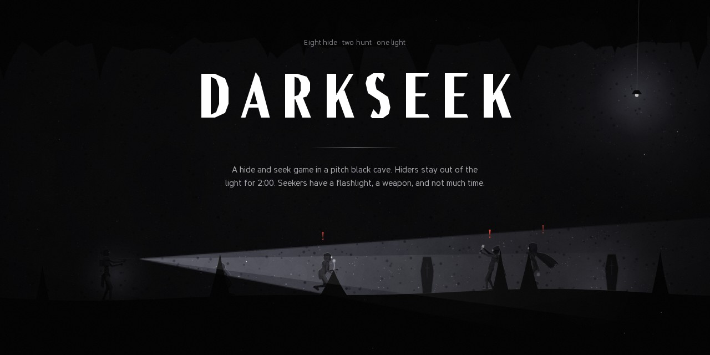
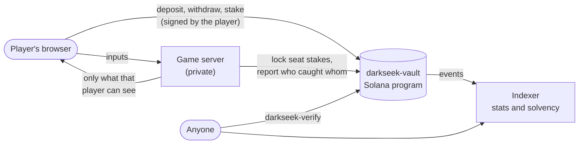

<p align="center">
  <a href="https://thedarkseek.xyz"></a>
</p>

# DarkSeek

**A Web3 hide and seek game on Solana.** Eight hide, two hunt, one light, and
every stake is held and paid out by an open program onchain.

[](https://thedarkseek.xyz)
[](https://thedarkseek.xyz/status)
[](https://thedarkseek.xyz/status)
[](https://github.com/nibblescreative-afk/darkseek/actions/workflows/ci.yml)
[](https://github.com/nibblescreative-afk/darkseek/actions/workflows/validator.yml)
[](programs/darkseek-vault)
[](LICENSE)

DarkSeek is a multiplayer hide and seek game played for stakes in a pitch
black cave. Hiders get a 10 second head start to vanish into the dark. Then
two Seekers, each with a flashlight and a weapon, have 2:00 to catch every one
of them. Catch them all and the Seekers win; leave one Hider standing and the
Hiders win.

It is a Web3 game because the money runs onchain. Players stake USDC from
their own vault in a Solana program, the program pays out every round, and the
fee split and the $DS token follow rules anyone can read here and check on the
chain. Play it at **[thedarkseek.xyz](https://thedarkseek.xyz)** (play money
until launch; practice rounds against bots are always free).

Why it exists and where it is going: [the vision](docs/VISION.md).

## How a round plays

- **Ten players, blind pick.** Eight Hiders and two Seekers pick from 14 2D
  characters in secret. Three Hiders are dealt a role at random: healer,
  jester or detective.
- **Hide.** Hiders get a 10 second head start while the Seekers wait in the
  dark. A Hider sees only a small circle around them.
- **Hunt.** A Seeker's light follows the mouse, and every attack has a 1.5
  second cooldown, whatever the weapon. The first hit wounds a Hider; the
  second catches them.
- **Win.** Seekers win only if every Hider is caught within 2:00. Otherwise
  the Hiders win.
- **People only.** A staked round starts only when all ten seats are staked by
  the people in them. No bot ever takes a staked seat and the house never
  plays.

Six rooms run at once, three casual and three pro, on an authoritative server
at 60 ticks a second. Each browser receives only what its player could see, so
a modified client has nothing hidden to reveal.

Controls, roles, payouts and a FAQ for players are in the
[wiki](https://github.com/nibblescreative-afk/darkseek/wiki).

## The money, onchain

| Stake per seat | Casual | Pro |
|---|---:|---:|
| Hider (8 seats) | 0.50 USDC | 2.50 USDC |
| Seeker (2 seats) | 1.50 USDC | 7.50 USDC |

- **Stakes.** A seat's stake is locked from the player's own vault when they
  sit down, and comes back in full if they leave before the round starts.
- **Payouts.** Each Seeker keeps the net stake (the stake minus the fee) of
  every Hider they caught. If every Hider is caught, the Seekers also get
  their own net stakes back; if not, the survivors get theirs back and split
  both Seekers' net stakes. The game server only reports who caught whom; the
  program does the math.
- **A 10% fee, split onchain.** 10% of it goes to $DS stakers, 20% back to the
  players who lost money that round (in $DS), 20% to buy back and burn $DS,
  and 50% to the treasury that runs the game. The treasury can never reach the
  other three.
- **Solvent by construction.** Custody equals everything the program owes, to
  the base unit, after every instruction. The tests check all 6,561 outcomes of
  a round and fuzz random sequences of every instruction against the real
  program; anyone can run the same check against a deployment
  ([solvency.md](docs/solvency.md)).
- **$DS.** A fixed supply token launched on pump.fun: no presale, no private
  allocation, and nobody can mint more. Staked $DS earns a share of every fee
  in USDC. Not launched yet; its address will be published in
  [deployments.md](docs/deployments.md) and on the site.

The [white paper](docs/WHITEPAPER.md) has the full rules, worked examples and
the buyback schedule.

## How it fits together



The game server runs the round; the program holds the money. The server can
lock a seat's stake (only under that player's session and daily cap), give it
back, start a full room and report who caught whom. It never chooses an
amount: every payout, the fee split and every $DS movement is computed by the
program from the published rules, within the limits in
[security-model.md](docs/security-model.md), and anyone can check it from a
public RPC.

## This repository

The game is the product. This repository is the part of it that touches money:
the Solana program that holds every stake and pays every round, the SDK and
tools to check it, the indexer that follows it, and the documents that say how
the economy works. If you play, review the economy or audit the code,
everything you need to check that there is no hidden code that harms players
is here.

```
programs/darkseek-vault   the onchain program (Anchor): vaults, rooms, settlement, fee split,
                          rebates, $DS staking, the buyback rule and auction, token locks
packages/sdk              TypeScript SDK and the darkseek-verify command
apps/indexer              follows the program, stores its events, serves /stats and /solvency
tests                     the program on a local validator and in LiteSVM
scripts                   build, IDL, cluster setup, a test only pump.fun shaped mint, release checks
tools/idl-build           builds the IDL without the Anchor CLI
docs                      white paper, security model, solvency, fairness, verification
```

Start with the [vision](docs/VISION.md) and the [white paper](docs/WHITEPAPER.md). Then:

- [security-model.md](docs/security-model.md): every power the game server and
  the admin have, and what they cannot do
- [solvency.md](docs/solvency.md): the invariants that keep every balance
  covered, and how to check them
- [fairness.md](docs/fairness.md): why the character you pay for does not
  decide the round, and why the house never plays
- [verify.md](docs/verify.md): bytecode, releases, settings, $DS and NFT
  checks, the website build
- [deployments.md](docs/deployments.md): the addresses we vouch for

## What stays private

The rest of the game stays private: the engine, the game server, the art, the
characters' animation and the website. A game anyone could clone would be
copied into look alike sites that take players' money, so we publish the part
that must be trusted and keep the part that must be played. None of the
guarantees about money depend on the private code: the program enforces them
whatever the game server does, and [security-model.md](docs/security-model.md)
lists exactly what the game server is trusted for (reporting who caught whom)
and how that trust is bounded. Each release publishes a hash of the website
build so you can check the site serves the released build.

## Check it

Nothing is deployed yet ([deployments.md](docs/deployments.md) will list the
official deployment). Once a deployment is listed, one command checks it from
any public RPC:

```sh
npm ci
npm run verify -- all --cluster devnet --program <program id> --usdc-mint <mint> --ds-mint <mint>
```

It checks the settings against the white paper, the $DS mint, solvency
(custody covers every balance owed) and the program hash. Details in
[verify.md](docs/verify.md). The same checks run in the tests against a local
validator.

## Build and test

Requirements: Rust (stable), the Agave CLI 4.4.1 (`cargo build-sbf`,
`solana-test-validator`) and Node 22.13 or later. The Anchor CLI is not needed.

```sh
npm ci
scripts/build-program.sh        # target/deploy/darkseek_vault.so
npm test                        # SDK unit tests
npm run test:program            # Rust unit tests, then the program on a local validator and in LiteSVM
npm run test:indexer            # the indexer against a local validator
npx tsx --test tests/invariants.test.ts   # fuzzing: random instruction sequences, books checked after every step
scripts/build-idl.sh            # programs/darkseek-vault/idl/darkseek_vault.json
```

The validator tests start their own `solana-test-validator` on ports 28899 and
up, deploy the program as upgradeable and run every scenario, checking after
each step that custody equals what the program owes, to the base unit.

## Roadmap

| Phase | Status |
|---|---|
| **Playable cave**: the cave, lighting, 14 characters, practice rounds | done |
| **Online rooms**: six rooms on an authoritative 60 Hz server, people only staked rounds (play money) | done |
| **Open onchain part**: this repository, with verifiable releases | done |
| **Devnet**: the program deployed from a tagged release, test money only | next |
| **Mainnet and $DS**: external audit, multisig upgrade authority, $DS launched on pump.fun | planned |
| **Seasons**: tournaments, replays, signed round results | planned |

Follow it on the [project board](https://github.com/users/nibblescreative-afk/projects/1), in the
[milestones](https://github.com/nibblescreative-afk/darkseek/milestones) and in the pinned
[Roadmap issue](https://github.com/nibblescreative-afk/darkseek/issues/12).

## Status

The game is playable at [thedarkseek.xyz](https://thedarkseek.xyz) with play
money. The program, version 0.2.1, is not deployed yet: devnet first, then
mainnet after an external audit and with the multisig upgrade authority
described in the [security model](docs/security-model.md). The code has not
been audited.

Live health, uptime, incidents and the exact build the site runs (with the
sha256 of every file it serves) are on the [status page](https://thedarkseek.xyz/status).

## Bugs and security

Found a bug in the game, the program, the SDK or the docs?
[Open an issue](https://github.com/nibblescreative-afk/darkseek/issues/new/choose).
Anything that could take or lock someone's funds must be reported privately
instead; see [SECURITY.md](SECURITY.md).

## License

[Business Source License 1.1](LICENSE). You may use this code for auditing,
verification, research and non commercial use. On 2030-11-20 it becomes
available under GPL 2.0 or later.
